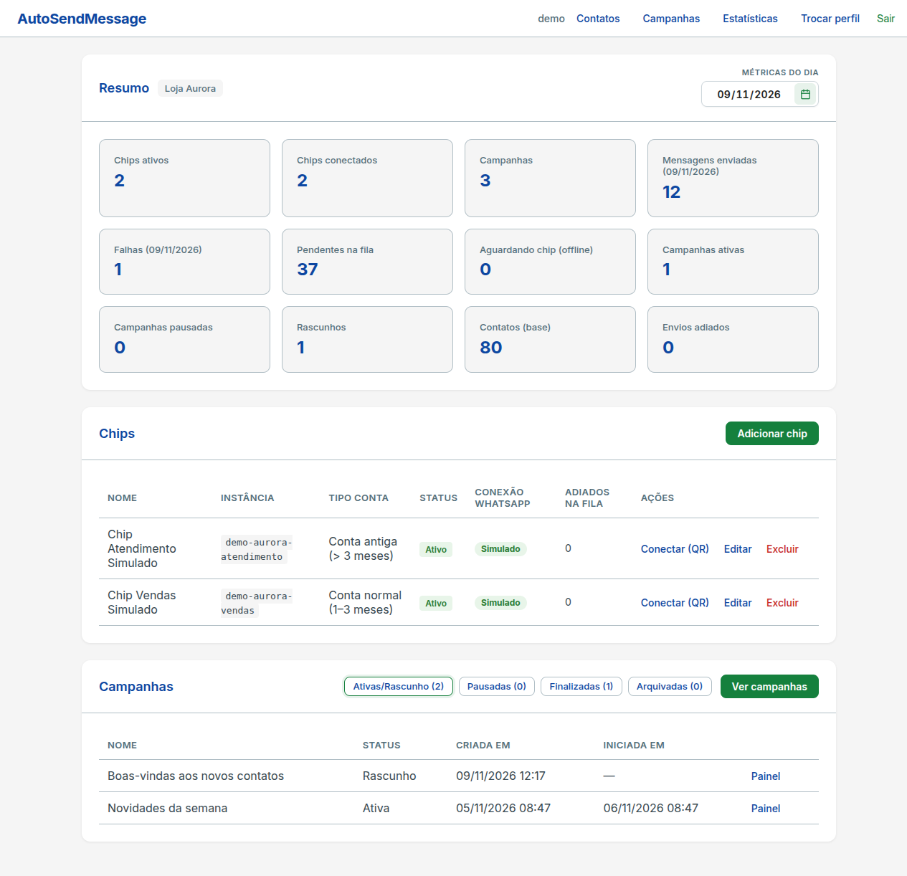
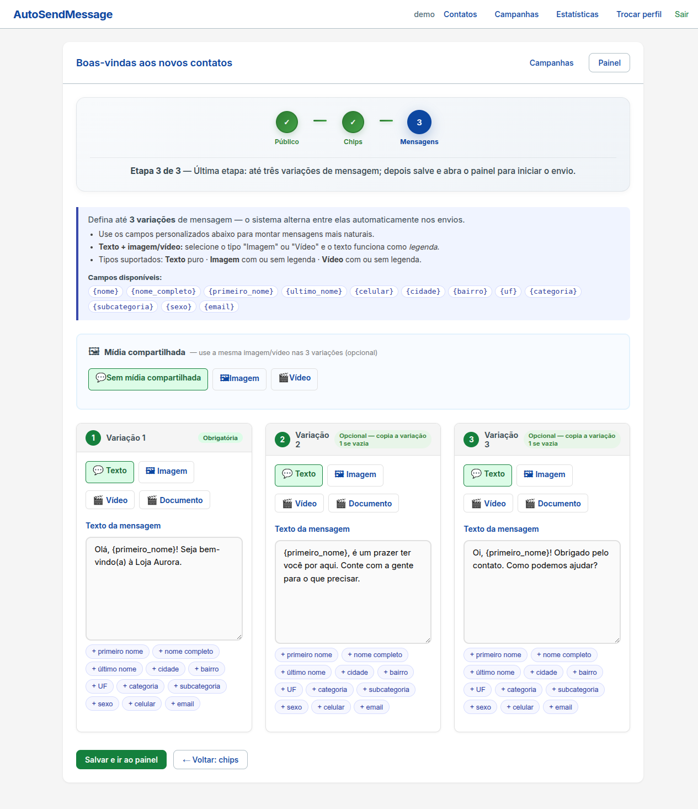
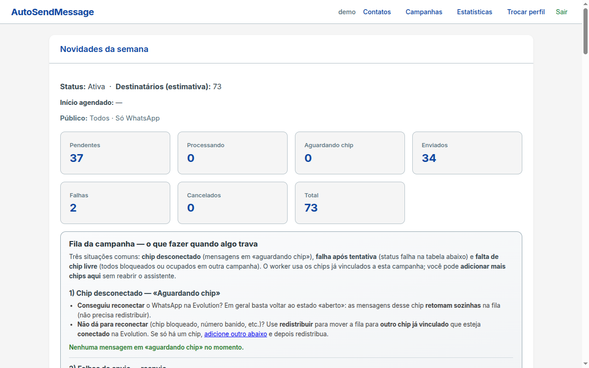
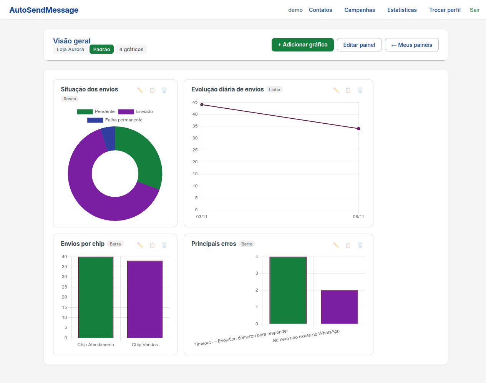
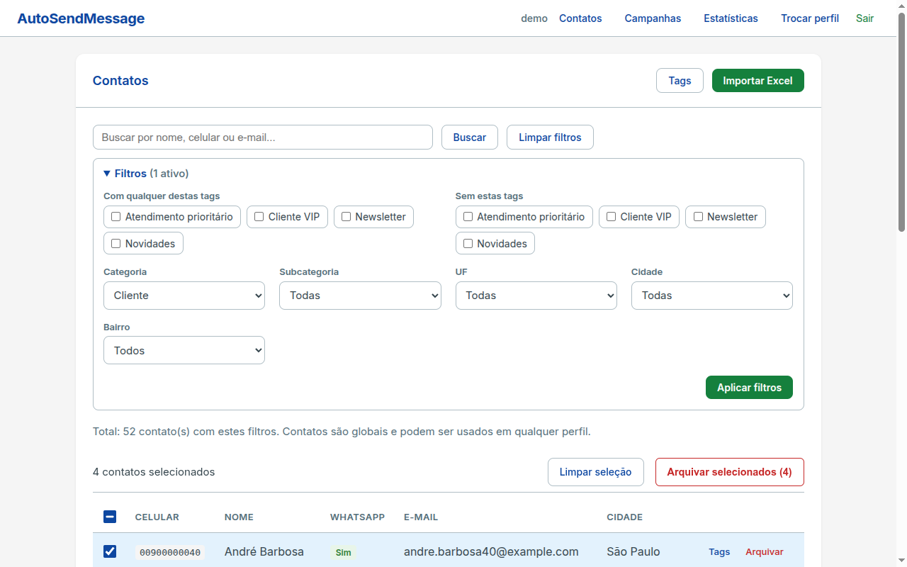
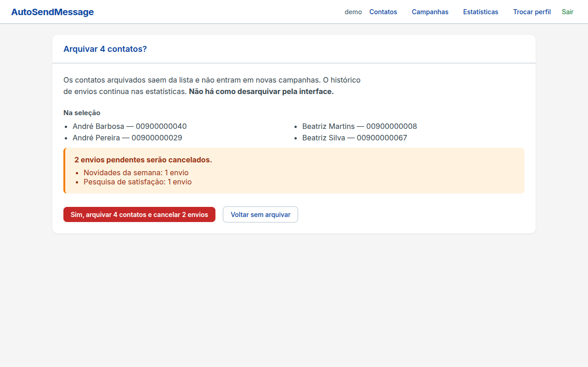

# AutoSendMessage

**Português:** [README.pt-BR.md](README.pt-BR.md)

A Django application that runs WhatsApp messaging campaigns under strict, per-number sending limits, so the numbers (SIM "chips") are less likely to get banned. It was built for a real outreach operation where five people used to send messages by hand; the system now does that work through a controlled queue.



All data in the screenshots and in the demo is fictional.

## The problem

WhatsApp bans numbers that send too much, too fast, or too uniformly. Doing this by hand is slow and error-prone; doing it with a naive script gets numbers banned. The system has to be fast enough to replace manual work and conservative enough to keep the numbers alive. That means per-number limits, human-looking timing, resilience when a number drops, and visibility into everything that was sent.

## Highlights

**Campaign wizard (3 steps)**
- Audience: presets (all contacts, birthdays of the day), filters (tag, category, subcategory, city, neighborhood, state), plus manual inclusion and exclusion of individual contacts.
- Chips: choose which numbers send the campaign.
- Messages: up to 3 variations (the wizard warns when variations are too similar), personalization fields such as `{primeiro_nome}`, `{nome}`, `{cidade}`, `{categoria}`, and optional image or video.

**Send queue and worker** (`python manage.py run_campaign_send_worker`)
- Jobs are claimed with a lock and a lease; if a worker dies, another one reclaims the job after the lease expires.
- Per-chip limits by account type (new, normal, old): messages per hour, per day, and a send window (time of day). Defaults, overridable per chip, are 5/h and 25/day for new accounts, 10/h and 75/day for normal ones, 20/h and 150/day for old ones.
- Humanized intervals: the delay between messages is drawn from a triangular distribution around the chip's base delay (never below 30 s, at most 10% earlier than the base, biased to be slower than the base), not a fixed sleep.
- A 2 to 3 minute pause every 25 messages sent in the day.
- Rate limiting reschedules a job instead of counting as a failure; each deferral records its reason (business hours, minimum interval, batch pause, hourly limit, daily limit).
- Retries with exponential backoff and a maximum number of attempts per job; every attempt is stored for auditing, and failures are classified by cause.
- Offline chip handling: when a chip's connection drops, its pending jobs are suspended in bulk instead of hammering the API, resumed automatically when the chip comes back, or redistributed round-robin to other chips of the campaign.
- Chip forms warn when configured hourly or daily limits exceed the recommended values for the account type.

**Pluggable providers** behind one interface (`apps/chips/providers/base.py`: `send_text`, `send_media`, `get_connection_state`, `format_number`)
- Evolution API
- Meta WhatsApp Business (Cloud) API
- A simulated provider that never touches the network, so the whole flow can be demonstrated without a real number. It is only offered when `SIMULATED_PROVIDER_ENABLED` is on.

**Contacts**
- Excel/CSV import wizard: upload, column mapping, preview, duplicate resolution, summary, import. A template spreadsheet is available for download. Limits: 5 MB and 10,000 rows.
- Bulk archiving: filter by tag, category and location, selection that persists across pages, "select all matching the search", and a confirmation step that shows which pending sends will be cancelled.

**Statistics**
- Configurable dashboards of widgets (bar, line, pie, doughnut) and CSV export.

## Screenshots

| | |
|---|---|
|  |  |
| Messages step: variations and personalization fields | Campaign queue panel |
|  |  |
| Statistics dashboard | Contact list with filters and selection |



Bulk archive confirmation, showing the pending sends that will be cancelled.

## Security

- The Meta access token is stored encrypted (Fernet) and is never sent back to the browser. The key comes from `FIELD_ENCRYPTION_KEY` or, if unset, is derived from `SECRET_KEY`.
- The Evolution QR-code webhook is authenticated by a token compared in constant time, and only accepts instances that exist as chips.
- Production settings come from the environment. With `DEBUG=False` the app refuses to start without a real `SECRET_KEY`, and enables secure cookies, HTTPS redirect and HSTS (configurable with `USE_HTTPS` and `TRUST_X_FORWARDED_PROTO`). CI runs `check --deploy --fail-level WARNING`.
- Exported CSV cells are neutralized against formula injection (`apps/common/utils/csv_safety.py`), and redirects to user-supplied URLs are validated against open redirects (`apps/common/utils/redirects.py`).
- CSRF protection is on for all forms. Instance names, Phone Number ID and API version are restricted to safe characters because they end up in external URLs. Uploads are checked by extension, content and size.

## Engineering

- One Django app per domain under `apps/`: `accounts`, `chips`, `contacts`, `campaigns`, `dashboards`, `common`.
- Business logic lives in a service layer (`apps/*/services/`), not in views.
- 273 test functions (counted with `grep -rc "def test_" apps`), run with `python manage.py test`.
- GitHub Actions (`.github/workflows/ci.yml`) runs `ruff check`, `ruff format --check`, `manage.py check`, a pending-migrations check, `check --deploy` and the test suite.
- Django 5.2, SQLite for local development, PostgreSQL in Docker, gunicorn and WhiteNoise for serving.

## Running it

### With Docker (recommended)

```bash
cp .env.example .env
# Edit .env: set SECRET_KEY and DB_PASSWORD (required), and SEED_DEMO=1 for fictional demo data.
docker compose up -d --build
docker compose exec web python manage.py createsuperuser
```

Open http://localhost:8000 and log in with the user you just created. The Compose stack runs the web app, the send worker and PostgreSQL, with the simulated provider enabled.

The Evolution API is optional and not needed for the demo. To run a real one alongside it, set `EVOLUTION_API_KEY` and `EVOLUTION_DB_PASSWORD` in `.env` and run `docker compose --profile evolution up -d`.

### Without Docker

```bash
python -m venv .venv
source .venv/bin/activate          # Windows: .venv\Scripts\activate
pip install -r requirements-dev.txt
cp .env.example .env               # set DEBUG=True, SIMULATED_PROVIDER_ENABLED=True
python manage.py migrate
python manage.py seed_demo         # needs DEBUG=True (or --force)
python manage.py createsuperuser
python manage.py runserver
```

In a second terminal, with the virtualenv active:

```bash
python manage.py run_campaign_send_worker
```

`SIMULATED_PROVIDER_ENABLED=True` is what makes the "Simulated" provider available in the chip form.

### Demo data

`seed_demo` creates fictional profiles, contacts, tags, simulated chips, campaigns, send history and dashboards. It is idempotent and creates no users or passwords. Every demo mobile number uses area code 00, which does not exist in Brazil, and the simulated provider sends nothing.

## Known limitations

- A profile (the `Workspace` model, called "Perfil" in the UI) organizes chips, campaigns and dashboards for a trusted team. It is **not** an access boundary: any authenticated user can pick, edit or delete any profile. Contacts are global. Do not host mutually untrusted teams in one installation.
- The interface is server-rendered Django templates, with no SPA. A visual redesign is still planned.

## License

All rights reserved. The source is published for portfolio evaluation; no license is granted to use, copy or modify it.
