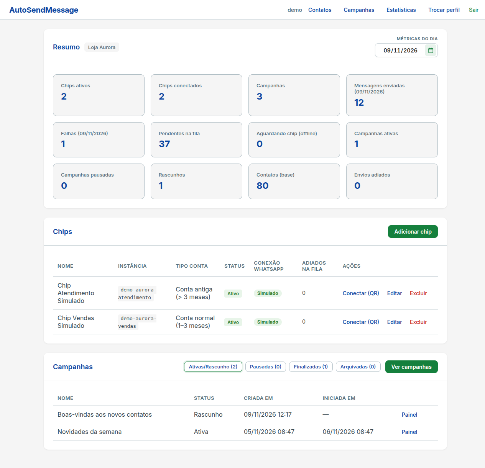
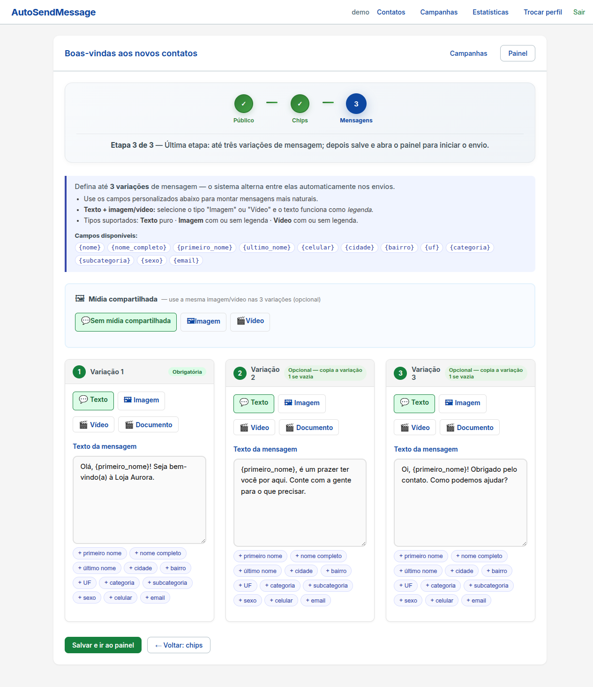
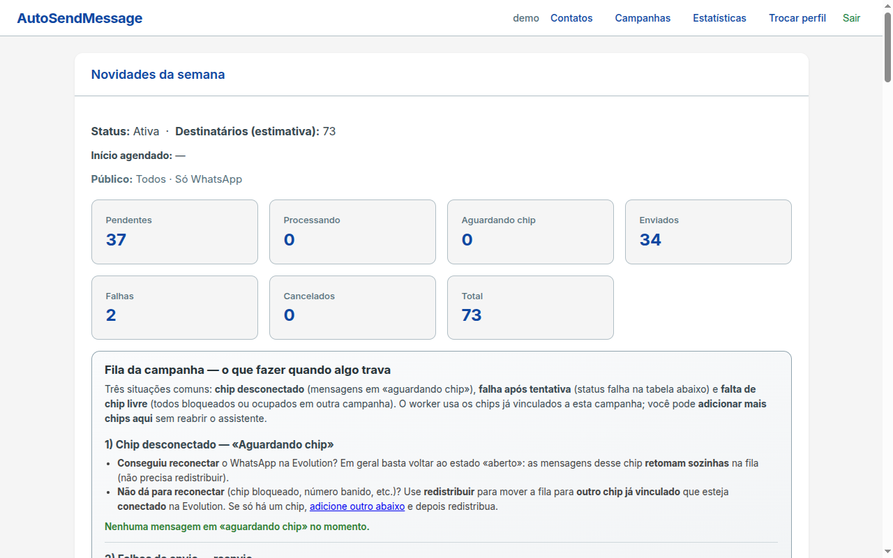
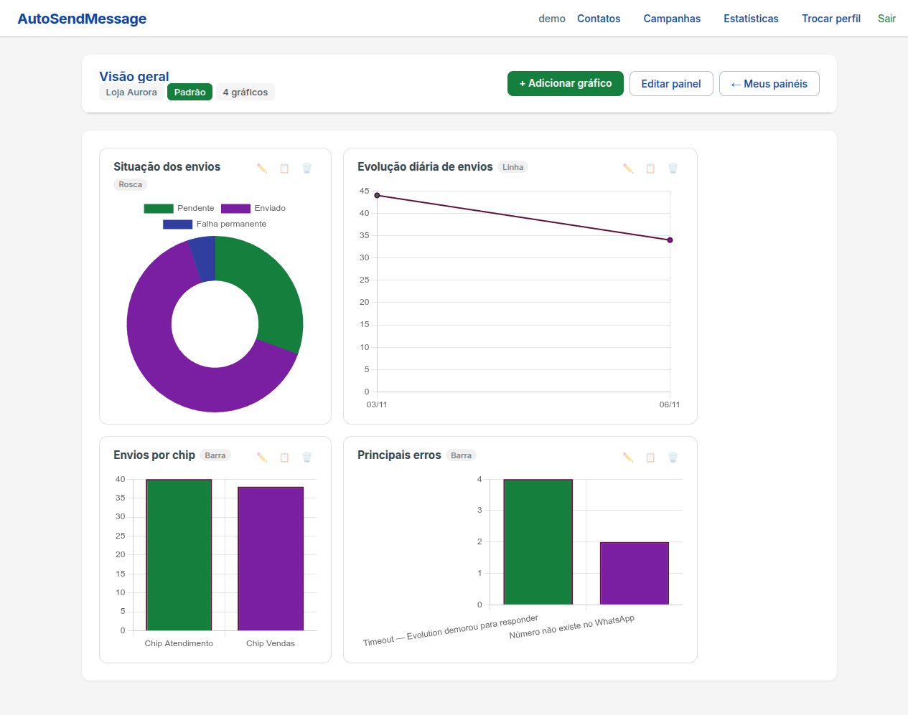
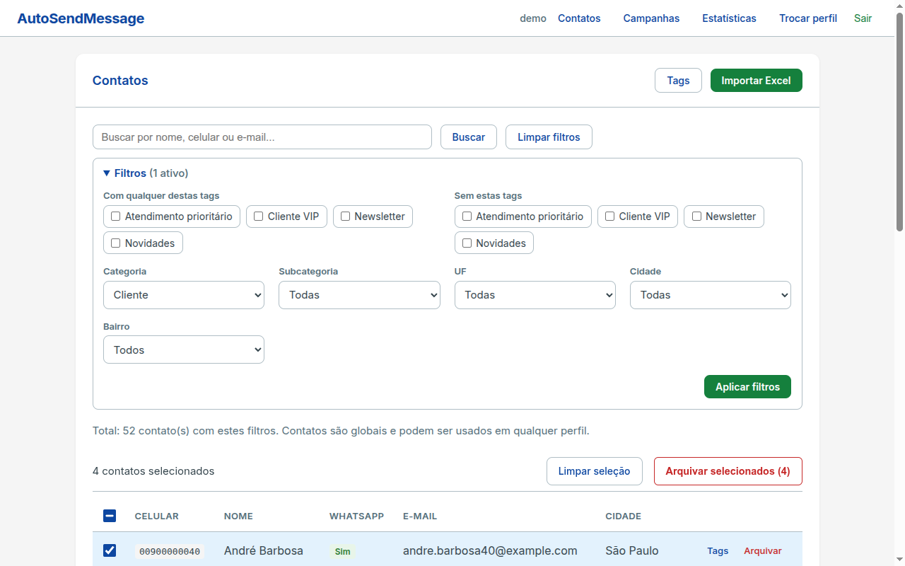
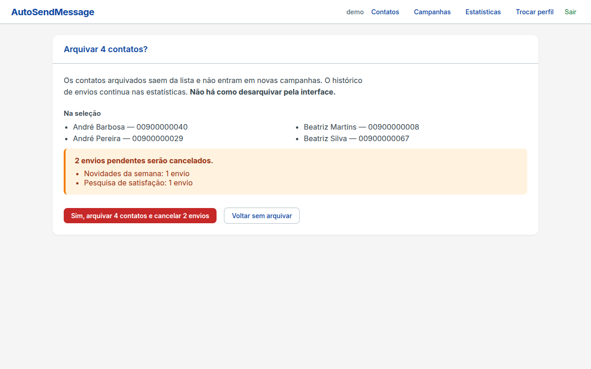

# AutoSendMessage

**English:** [README.md](README.md)

Aplicação Django que executa campanhas de mensagens de WhatsApp com limites rígidos por número (chip), para reduzir o risco de bloqueio. Foi feita para uma operação real de contato em que cinco pessoas enviavam as mensagens à mão; hoje o sistema faz esse trabalho por uma fila controlada.



Todos os dados das capturas e da demonstração são fictícios.

## Destaques

- **Assistente de campanha em 3 etapas:** público (todos, aniversariantes do dia, filtros por tag, categoria, cidade, UF etc., com inclusão e exclusão manual), chips e até 3 variações de mensagem com campos de personalização (`{primeiro_nome}`, `{cidade}`...) e imagem ou vídeo.
- **Fila de envio com worker** (`python manage.py run_campaign_send_worker`): trava com lease, limites por chip conforme o tipo de conta (nova, normal, antiga), janela de horário, intervalos humanizados (distribuição triangular em torno do atraso base, nunca abaixo de 30 s), pausa de 2 a 3 minutos a cada 25 mensagens no dia, retentativas com backoff exponencial e auditoria de cada tentativa.
- **Chip offline:** os envios pendentes são suspensos em lote, retomados quando o chip volta ou redistribuídos entre os outros chips da campanha. O formulário de chip avisa quando os limites configurados passam do recomendado.
- **Provedores plugáveis** atrás de uma interface (`apps/chips/providers/base.py`): Evolution API, Meta WhatsApp Business API e um provedor **simulado**, que não envia nada, para demonstração.
- **Contatos:** importação de Excel/CSV com mapeamento de colunas, tratamento de duplicados e planilha modelo; arquivamento em lote com filtros, seleção persistente entre páginas, "selecionar todos da busca" e confirmação que mostra os envios pendentes que serão cancelados.
- **Estatísticas:** painéis configuráveis (barra, linha, pizza, rosca) e exportação CSV.
- **Segurança:** token da Meta cifrado (Fernet), webhook do QR Code autenticado por token, settings de produção por variáveis de ambiente, proteção contra CSV injection e open redirect, CSRF.
- **Engenharia:** um app Django por domínio em `apps/`, camada de services, 273 funções de teste e CI (`.github/workflows/ci.yml`) com ruff, `check`, verificação de migrations, `check --deploy` e testes.

## Capturas de tela

| | |
|---|---|
|  |  |
|  |  |



## Como rodar

### Com Docker (recomendado)

```bash
cp .env.example .env
# Edite o .env: defina SECRET_KEY e DB_PASSWORD (obrigatórias) e SEED_DEMO=1 para dados fictícios.
docker compose up -d --build
docker compose exec web python manage.py createsuperuser
```

Acesse http://localhost:8000. O Compose sobe o app, o worker e o PostgreSQL, com o provedor simulado ligado. A Evolution API é opcional: defina `EVOLUTION_API_KEY` e `EVOLUTION_DB_PASSWORD` no `.env` e rode `docker compose --profile evolution up -d`.

### Sem Docker

```bash
python -m venv .venv
source .venv/bin/activate          # Windows: .venv\Scripts\activate
pip install -r requirements-dev.txt
cp .env.example .env               # defina DEBUG=True e SIMULATED_PROVIDER_ENABLED=True
python manage.py migrate
python manage.py seed_demo         # exige DEBUG=True (ou --force)
python manage.py createsuperuser
python manage.py runserver
```

Em um segundo terminal, com a venv ativa: `python manage.py run_campaign_send_worker`.

### Dados de demonstração

`seed_demo` cria perfis, contatos, chips simulados, campanhas e histórico fictícios, sem criar usuários. Todos os celulares usam DDD 00, que não existe no Brasil, e o provedor simulado não envia nada.

## Limitações conhecidas

- O perfil (model `Workspace`) organiza chips, campanhas e painéis de uma equipe de confiança, mas **não** é uma fronteira de acesso: qualquer usuário autenticado pode escolher, editar e excluir qualquer perfil. Os contatos são globais. Não hospede equipes que não devam se enxergar na mesma instalação.
- A interface é renderizada no servidor (templates Django), sem SPA. O redesign visual ainda vai acontecer.

## Licença

Todos os direitos reservados. O código-fonte é publicado para avaliação de portfólio; nenhuma licença é concedida para usar, copiar ou modificar.
